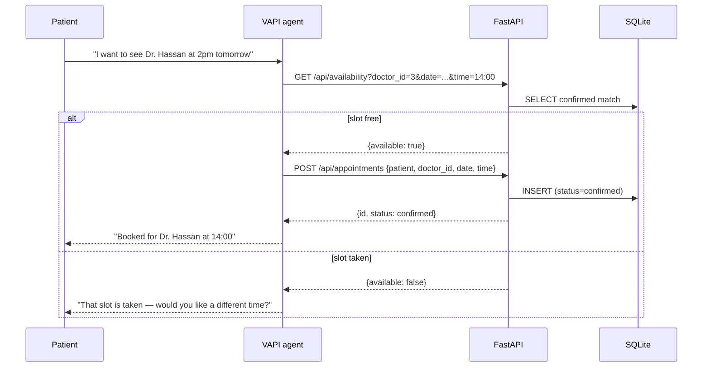
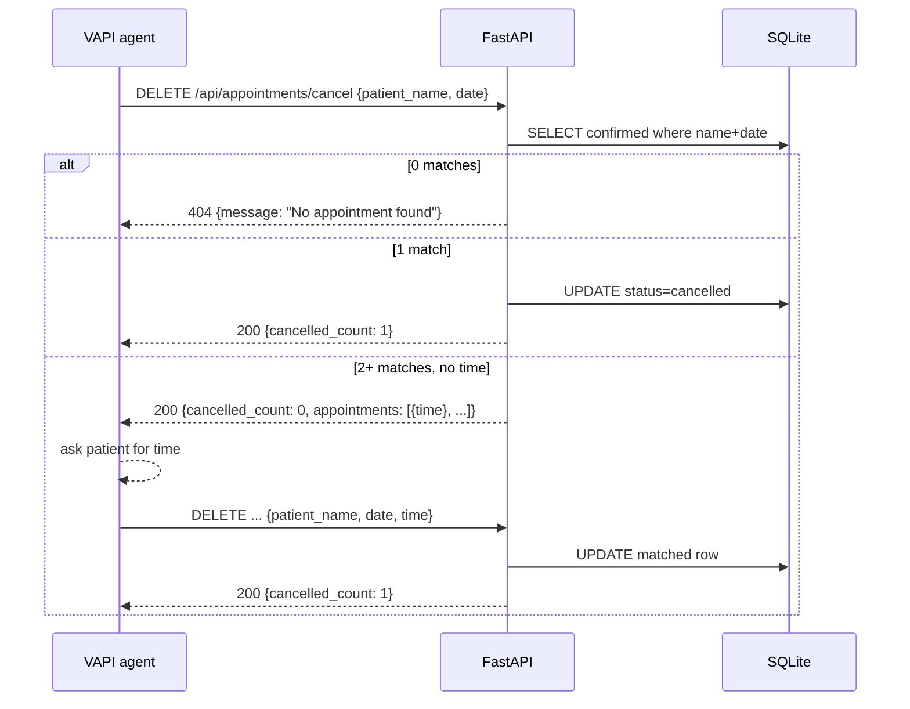

# VAPI Voice Agent — Technical Architecture

**Document Type:** Technical Architecture Reference
**Document:** technical-architecture.md
**Status:** Living document
**Version:** 1.0
**Owner:** [TODO: owner]
**Last Updated:** 2026-07-27
**Product:** "Alex" voice receptionist for Apollo Wellness Hospital
**Audience:** Engineering
**Related Documents:** `AGENT.md`, `specs/*/spec.md`, `specs/*/plan.md`, `.specify/memory/constitution.md`

---

## Overview & Purpose

VAPI Voice Agent ("Wayu" / "CityCare") is a voice-first hospital appointment booking system. Patients call a phone number → VAPI (external voice provider) handles the conversation → VAPI's tools call a FastAPI backend over HTTP → the backend reads/writes a local SQLite database. A Streamlit test dashboard (`dummy_frontend.py`) exercises all endpoints manually, and a Next.js marketing frontend (`frontend/`) showcases the product with an embedded voice widget.

This document is the canonical technical architecture reference: it captures the locked engineering decisions, the system topology across the voice, API, data, and presentation planes, and the component-by-component design. It is the single source of truth for how the system is structured and why each major technology choice was made.

> **Status note:** This document is maintained as a living reference; see the Change Log for revisions.

## Scope & Audience

**Audience:** Engineering — backend, frontend, voice-configuration, and integration engineers building or extending this system.

**In scope:** Locked architecture decisions; system overview and component map; flat-file repository layout; backend (FastAPI); voice layer (VAPI tools + system prompt); data layer (SQLite + SQLAlchemy); Next.js frontend; API conventions; key sequence flows; tech stack summary; feature-to-architecture mapping.

**Out of scope:** Infrastructure provisioning and CI/CD (n/a — local dev via ngrok); security/compliance in depth (single-tenant, no auth by design); UX and design system details (see `frontend/`); product requirements (see `specs/`).

---

## 0. Locked Decisions (overrides and pins)

These decisions are final for v1 and override any conflicting guidance:

| # | Decision | Notes |
|---|---|---|
| D1 | **SQLite file `hospital.db` at repository root**, managed by SQLAlchemy 2.x | No external DB server. `connect_args={"check_same_thread": False}`; no auth, single-tenant, local dev. |
| D2 | **Flat-file layout at repo root** — no `src/` or `backend/` nesting | `backend.py`, `database.py`, `dummy_frontend.py`, `db_demo.py` all live at root. Constitution-locked; new top-level files require a ratified ADR. |
| D3 | **`backend.py` is the only file that imports from `database.py`; `dummy_frontend.py` must NOT touch the DB** | Streamlit dashboard talks to the backend via HTTP (`requests`) only — pure API client, no SQLAlchemy imports. |
| D4 | **VAPI is the exclusive voice/telephony layer** | Configured in the VAPI dashboard (not code): tools call backend endpoints, system prompt drives the conversation. ngrok exposes port 8000 and the tunnel URL changes per restart → CORS is fully open. |
| D5 | **Soft-delete only** — appointments are never hard-deleted | Cancellation = `status = "cancelled"`. No `DELETE` of rows, no `DROP`. |
| D6 | **All dates `YYYY-MM-DD`, times `HH:MM` (24h), stored as strings** | Matches VAPI tool contracts and SQLite string comparison. |
| D7 | **Constants at top of file; every function has a docstring** | No hardcoded values inside function bodies; enforced per spec FR-007/FR-006. |
| D8 | **No direct SQL in `backend.py`** | All DB access through the SQLAlchemy session from `get_db()`; models imported from `database.py`, never redefined. |
| D9 | **Availability is a computed query, not a stored value** | Slot free ⇔ zero rows with `doctor_id + date + time + status='confirmed'`. No schema change. |
| D10 | **Single FastAPI application, one endpoint per route** | No routers/microservices for v1. Startup event calls `init_db()`. |

---

## 1. System Overview

A patient calls → VAPI handles speech recognition/synthesis + conversation logic → VAPI tools hit FastAPI endpoints → FastAPI reads/writes SQLite via SQLAlchemy. The Next.js site and Streamlit dashboard are parallel consumers of the same API.

### 1.1 Components

| Component | Runs on | Purpose |
|---|---|---|
| `VAPI` (external) | VAPI cloud | Voice call handling, STT/TTS, conversation flow; configured via dashboard tools + system prompt |
| `ngrok` | Local machine | HTTPS tunnel → `http://localhost:8000` so VAPI can reach the backend; URL changes per restart |
| `backend.py` (FastAPI) | Local `uvicorn` | All REST APIs: booking, cancel, list, doctors, availability |
| `database.py` (SQLAlchemy) | Local | Engine, `SessionLocal`, ORM models (`Doctor`, `Appointment`), `get_db()` generator, `init_db()` seed |
| `hospital.db` (SQLite) | Local file | Relational storage — doctors + appointments |
| `dummy_frontend.py` (Streamlit) | Local `streamlit` | Manual test dashboard: Schedule / Cancel / Check tabs; HTTP-only API client |
| `db_demo.py` (raw sqlite3) | Local CLI | Read-only DB inspection with labelled output; stdlib only |
| `frontend/` (Next.js) | Local `npm run dev` | Marketing/demo site "CityCare" with embedded `VoiceWidget` (VAPI SDK) |

### 1.2 Architecture diagram

```mermaid
flowchart TB
    subgraph Patients
        P[Patient on phone]
    end

    subgraph VAPI_Cloud [VAPI Cloud]
        VA[Voice Agent<br/>tools + system prompt]
    end

    subgraph Local [Local dev machine]
        API[backend.py - FastAPI<br/>/api/* endpoints]
        DB[hospital.db - SQLite]
        DASH[Streamlit dummy_frontend.py]
        DEMO[db_demo.py]
        WEB[frontend/ - Next.js CityCare]
        WIDGET[VoiceWidget.tsx - @vapi-ai/web]
    end

    NG[ngrok tunnel]

    P -->|phone call| VA
    VA -->|HTTPS tools| NG
    NG --> API
    API --> DB
    DASH -->|requests| API
    DEMO -->|raw sqlite3| DB
    WEB --> WIDGET
    WIDGET -->|@vapi-ai/web| VA
    WEB -->|fetch server-side| API
```

### 1.3 Key flows at a glance

- **Book:** Patient → VAPI agent → `check_availability` tool (`GET /api/availability`) → `book_appointment` tool (`POST /api/appointments`) → confirmed row in SQLite → agent reads confirmation.
- **Cancel:** Agent → `DELETE /api/appointments/cancel` with name + date → if multiple matches, response includes time-slot list → agent reads options → re-call with `time` → soft-cancel.
- **Check/list:** Agent or dashboard → `GET /api/appointments?date=YYYY-MM-DD` (+ optional `patient_name`).
- **DB inspection:** Dev runs `uv run python db_demo.py` → labelled doctors, appointments, confirmed/cancelled counts.

---

## 2. Repository Layout

Flat, constitution-locked. `src/` and `tests/` in `AGENTS.md` are aspirational placeholders — the live layout is root-level Python files.

```text
VAPI-VOICE-AGENT/
├── backend.py              # FastAPI app — all endpoints (see §3)
├── database.py             # Engine, SessionLocal, Base, Doctor, Appointment (see §6)
├── dummy_frontend.py       # Streamlit test dashboard (3 tabs, HTTP-only)
├── db_demo.py              # Read-only DB inspector (raw sqlite3, stdlib only)
├── pyproject.toml          # uv-managed; FastAPI, SQLAlchemy, uvicorn, streamlit, requests
├── hospital.db             # SQLite runtime artifact (gitignored)
├── frontend/               # Next.js 15 marketing site (see §5)
│   ├── app/                # layout.tsx, page.tsx, globals.css
│   └── components/         # Hero, VoiceWidget, CityCareContext, CityCareTweaksPanel, ...
├── specs/                  # SpecKit Plus SDD docs per feature (001–004)
├── history/                # PHRs (prompts/) — prompt history records
├── .specify/               # Templates, scripts, constitution
├── docs/                   # ← this document
└── .env                    # NEXT_PUBLIC_VAPI_* keys (gitignored)
```

Rules:

- Backend has **no required env vars** (SQLite local, no auth). Frontend requires `NEXT_PUBLIC_VAPI_PUBLIC_KEY` + `NEXT_PUBLIC_VAPI_ASSISTANT_ID`.
- `dummy_frontend.py` never imports SQLAlchemy / DB drivers.
- `database.py` contains zero HTTP/business logic — data-access only.
- `db_demo.py` uses only the Python standard library (`sqlite3`).

---

## 3. Backend Architecture (FastAPI)

### 3.1 Project structure

Single file, flat. Endpoints + Pydantic models only — no routers, no services layer.

```text
backend.py
├── Constants            # STATUS_CONFIRMED, STATUS_CANCELLED, MSG_* strings
├── app = FastAPI()      # + CORSMiddleware(allow_origins=["*"])
├── startup_event()      # → init_db()
├── Pydantic models      # AppointmentRequest, AppointmentResponse, CancelAppointmentRequest, CancelAppointmentResponse
└── Endpoints            # POST/DELETE/GET /api/appointments, GET /api/availability, GET /api/doctors
```

### 3.2 Dependency injection

Every endpoint takes `db: Session = Depends(get_db)`. `get_db()` (in `database.py`) is a generator that yields one session and closes it in a `finally` block — safe on both success and exception.

```python
# database.py
def get_db():
    """Yield a database session and ensure it is closed after use."""
    db = SessionLocal()
    try:
        yield db
    finally:
        db.close()
```

### 3.3 Endpoint contracts

| Method | Path | Purpose | Status codes |
|---|---|---|---|
| POST | `/api/appointments` | Create confirmed appointment | 200 created, 404 doctor not found, **409 slot booked** |
| DELETE | `/api/appointments/cancel` | Soft-cancel by name+date (+optional time) | 200, 404 none/not found |
| GET | `/api/appointments?date=` | List by date (+ optional `patient_name`) | 200 (empty list ok) |
| GET | `/api/availability` | Check slot free | 200 |
| GET | `/api/doctors` | List all doctors | 200 |

### 3.4 Double-booking prevention (D9, feature 004)

Both the read check and the write guard apply the **same rule** — a slot is available iff zero confirmed rows match `doctor_id + date + time`:

```python
conflicting = (
    db.query(Appointment)
    .filter(
        Appointment.doctor_id == request.doctor_id,
        Appointment.date == request.date,
        Appointment.time == request.time,
        Appointment.status == STATUS_CONFIRMED,
    )
    .first()
)
if conflicting:
    raise HTTPException(status_code=409, detail={"message": MSG_SLOT_BOOKED})
```

Race condition note: two concurrent requests could both pass the check. Accepted for expected low concurrency; a partial unique index on `(doctor_id, date, time) WHERE status='confirmed'` is the documented escalation path.

### 3.5 Error conventions

All errors raise `HTTPException` with `detail={"message": "..."}`. Validation failures use FastAPI's default 422 envelope. No internal details leaked; machine-readable `message` is VAPI-agent friendly.

---

## 4. Voice Layer (VAPI)

VAPI owns the full conversation. This layer is **not code** — it is dashboard configuration plus the system prompt, and must be manually kept in sync with `contracts/availability-api.md`.

### 4.1 Tools (VAPI dashboard)

| Tool | HTTP method | Endpoint | Params |
|---|---|---|---|
| `check_availability` | GET | `https://<ngrok>.ngrok-free.app/api/availability` | `doctor_id` (int), `date` (YYYY-MM-DD), `time` (HH:MM) |
| `book_appointment` | POST | `https://<ngrok>.ngrok-free.app/api/appointments` | `patient_name`, `reason`, `date`, `time`, `doctor_id` |
| `cancel_appointment` | DELETE | `https://<ngrok>.ngrok-free.app/api/appointments/cancel` | `patient_name`, `date`, `time?` |
| `list_appointments` | GET | `https://<ngrok>.ngrok-free.app/api/appointments` | `date`, `patient_name?` |
| `list_doctors` | GET | `https://<ngrok>.ngrok-free.app/api/doctors` | — |

### 4.2 System prompt rules (booking flow)

> Before booking an appointment, always call `check_availability` first with the doctor_id, date, and time the patient requested. If the response shows `available: false`, tell the patient "I'm sorry, that time slot is not available for Dr. [name] on that date. Would you like to try a different time?" and wait for their response. If `available: true`, proceed with the `book_appointment` tool.

### 4.3 Personas & moods (frontend voice widget)

Runtime-switchable persona (`receptionist` | `nurse` | `concierge`) and mood (`apothecary` | `midnight` | `clinical` | `bedside`) drive the widget greeting, FAB label, and CSS theme via `CityCareContext.tsx`.

---

## 5. Frontend Architecture (Next.js on localhost)

Marketing/demo site "CityCare" — Next.js 15 App Router, React 19, TypeScript, Tailwind. Deploys nowhere (local `npm run dev`); Vercel is the natural target if published.

### 5.1 Structure

```text
frontend/
├── app/
│   ├── layout.tsx        # fonts (Instrument Serif, Cormorant, Fraunces, Geist), metadata
│   ├── page.tsx          # 'use client' — CityCareCtx.Provider, sections, VoiceWidget
│   └── globals.css       # theme + widget styles (data-mood / data-display)
└── components/
    ├── VoiceWidget.tsx       # @vapi-ai/web SDK — mic, transcript thread, chips
    ├── CityCareContext.tsx   # personas + moods constants, context provider
    ├── CityCareTweaksPanel.tsx / TweaksPanel.tsx  # dev switcher (mood/persona/display)
    └── Hero, Nav, Capabilities, Stats, How, Departments, Stories, CtaBand, Footer, ...
```

### 5.2 Voice widget (`VoiceWidget.tsx`)

Client component instantiating `new Vapi(NEXT_PUBLIC_VAPI_PUBLIC_KEY!)`, wired to lifecycle events (`call-start`, `call-end`, `speech-start`, `speech-end`, `message`, `error`). Mic press → `vapi.start(NEXT_PUBLIC_VAPI_ASSISTANT_ID!)`. Transcript thread rendered as chat bubbles; quick chips + text input send via `vapi.send({type:'add-message', ...})`.

### 5.3 Theming

Mood/display selected in `TweaksPanel` set `data-mood` / `data-display` on `<html>`; `globals.css` keys off these attributes. Content copy (greeting, CTAs) swaps by persona from `CITYCARE_PERSONAS`.

---

## 6. Data Architecture

### 6.1 Engine & models (`database.py`)

| Model | Columns |
|---|---|
| `Doctor` | `id` (PK, autoincrement), `name` (str, req), `specialty` (str, req), `created_at` (UTC datetime) |
| `Appointment` | `id` (PK), `patient_name` (req), `reason` (req), `date` (YYYY-MM-DD), `time` (HH:MM), `doctor_id` (FK → doctors.id), `status` (`confirmed`\|`cancelled`), `created_at` |

`SEED_DOCTORS` constant seeds exactly 3 on first `init_db()`: Dr. Ahmed/Cardiology, Dr. Fatima/Gynecology, Dr. Hassan/General — only when the doctors table is empty (idempotent).

### 6.2 Data invariants

- **No hard deletes.** `status` transitions `confirmed → cancelled` only.
- **Availability rule:** `doctor_id + date + time + status='confirmed'` uniqueness (application-enforced, not a DB constraint).
- Cancelled appointments **do not block** future bookings of the same slot.
- `created_at` defaults to UTC via `datetime.now(timezone.utc)`.

---

## 7. API Design Conventions

- **Prefix:** every path begins `/api/`.
- **Format:** all dates `YYYY-MM-DD`, all times `HH:MM` (24h), stored as strings.
- **Errors:** non-2xx responses always carry a JSON `message` field. 404 = doctor/appointment not found; 409 = slot already booked; 422 = validation.
- **Idempotency:** cancellation is naturally idempotent (re-cancelling a cancelled appointment → 404, no state corruption). Booking is protected by the conflict check, not by idempotency keys.
- **CORS:** fully open (`allow_origins=["*"]`) because the ngrok tunnel URL rotates on every restart.

---

## 8. Key Sequence Flows

### 8.1 Booking with availability check (feature 004)



### 8.2 Ambiguous cancellation



---

## 9. Tech Stack Summary

| Layer | Choice | Version |
|---|---|---|
| Runtime | Python + `uv` | 3.11+ |
| API framework | FastAPI | 0.115.x |
| ASGI server | Uvicorn | 0.34.x |
| ORM | SQLAlchemy | 2.x |
| Validation | Pydantic | v2 |
| Database | SQLite (`hospital.db`) | built-in |
| Test dashboard | Streamlit | 1.30–2.0 |
| HTTP client (dashboard) | requests | 2.31+ |
| DB inspection | raw sqlite3 (stdlib) | — |
| Voice provider | VAPI (`@vapi-ai/web` 2.5.2) | external |
| Tunnel | ngrok | — |
| Frontend | Next.js (App Router) | 15.x |
| UI libs | React / TypeScript / Tailwind | 19 / 5 / 4 |

---

## 10. Feature → Architecture Mapping

| Feature (spec) | Architecture components |
|---|---|
| 001 — Database layer | `database.py`: engine, models, `get_db()`, `init_db()`; `db_demo.py` |
| 002 — Backend API | `backend.py`: 4 endpoints, Pydantic models, CORS, error envelope |
| 003 — Test dashboard | `dummy_frontend.py`: 3-tab Streamlit, HTTP-only client |
| 004 — Availability + double-booking | `GET /api/availability` + conflict check in `POST` + VAPI tool/prompt |

---

## Open Questions / TODOs

1. **Document owner unassigned** — see metadata `Owner: [TODO: owner]`.
2. **Frontend deployment target** — currently local-only; Vercel is the implied production path but unratified.
3. **Product name drift** — `AGENT.md` says "Wayu"; `frontend/package.json` and marketing copy say "CityCare". ADR needed to lock the brand.
4. **VAPI config not in version control** — tool definitions + system prompt are manual dashboard edits; consider exporting as code (contracts/ documents the current shape).
5. **No automated tests** — verification is manual via Swagger UI / curl / Streamlit. A pytest suite is a candidate follow-up.
6. **Race condition on concurrent booking** — accepted for low concurrency; partial unique index is the escalation path (see §3.4).

## Change Log

| Date | Change | Author |
|---|---|---|
| 2026-07-27 | Initial document authored from AGENT.md + specs/001–004 + source review; ZensZoom reference-doc format adopted | Agent |
